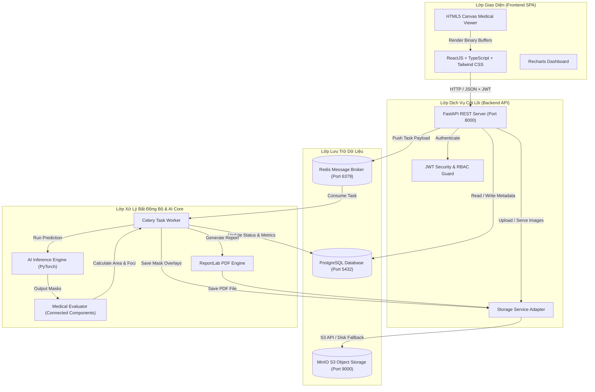
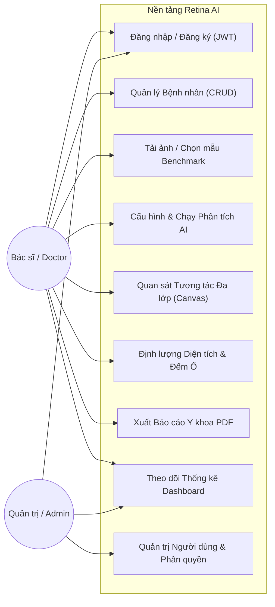
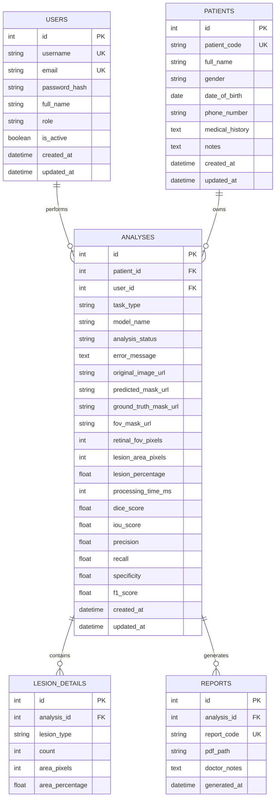
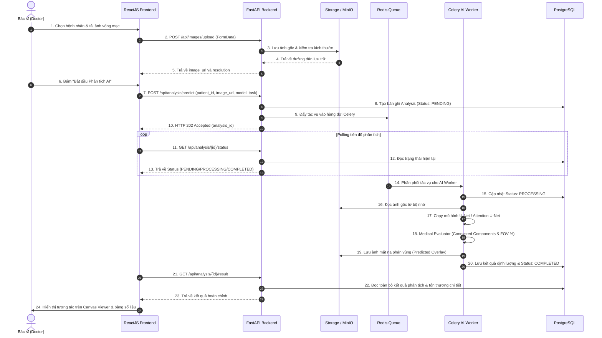
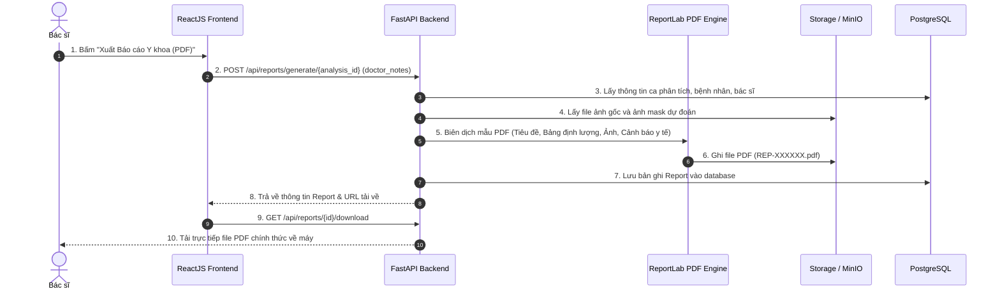

# CHƯƠNG 3: PHÂN TÍCH VÀ THIẾT KẾ HỆ THỐNG

**Đồ án chuyên ngành 2 – Trường Đại học Công nghệ Thông tin và Truyền thông Việt - Hàn (VKU)**  
**Đề tài:** Nền tảng phân vùng và định lượng tổn thương y khoa tự động ứng dụng mô hình học sâu (Deep Learning)  

---

## 3.1. KIẾN TRÚC TỔNG THỂ HỆ THỐNG (SYSTEM ARCHITECTURE)

Hệ thống được thiết kế theo mô hình Microservices phân tách rành mạch giữa giao diện người dùng, dịch vụ API, hàng đợi xử lý tác vụ nặng và tầng suy luận Deep Learning.

---

## 3.2. BIỂU ĐỒ VÀ ĐẶC TẢ USE CASE (USE CASE SPECIFICATION)

### 3.2.1. Tác nhân hệ thống (Actors)
1. **Bác sĩ Nhãn khoa / Nhà nghiên cứu (Doctor / Researcher):**
   - Đăng nhập, đăng ký tài khoản.
   - Quản lý hồ sơ bệnh nhân (Thêm, sửa, tìm kiếm bệnh án).
   - Tải lên ảnh đáy mắt võng mạc hoặc chọn mẫu dữ liệu chuẩn IDRiD/DRIVE.
   - Lựa chọn mô hình Deep Learning (U-Net hoặc Attention U-Net) và loại nhiệm vụ (Tổn thương hoặc Mạch máu).
   - Kích hoạt tiến trình phân tích bất đồng bộ và theo dõi tiến độ.
   - Thao tác trên HTML5 Canvas Viewer (Phóng to, thu nhỏ, di chuyển, trượt chia màn hình Split Slider, bật tắt nhãn tổn thương, chỉnh Opacity).
   - Xem bảng chỉ số định lượng diện tích và đếm số ổ tổn thương.
   - Kết xuất và tải phiếu kết quả xét nghiệm định dạng PDF.
2. **Quản trị viên Hệ thống (System Administrator):**
   - Toàn quyền quản trị tài khoản người dùng, phân quyền truy cập.
   - Giám sát tình trạng hạ tầng (Database, Redis Queue, MinIO, GPU CUDA).
   - Đánh giá tổng hợp chỉ số hiệu năng thực nghiệm của các phiên bản mô hình AI.

---

## 3.3. THIẾT KẾ CƠ SỞ DỮ LIỆU (DATABASE ERD & SCHEMAS)

Cơ sở dữ liệu được thiết kế theo chuẩn 3NF (Third Normal Form), bảo đảm tính toàn vẹn tham chiếu, tối ưu hóa tốc độ truy vấn qua các chỉ mục (Index) và quan hệ chặt chẽ giữa các thực thể.

### Chi tiết các thực thể:
1. **`users`:** Lưu thông tin tài khoản bác sĩ và quản trị viên, mật khẩu được băm an toàn bằng thuật toán bcrypt.
2. **`patients`:** Lưu trữ lý lịch y bạ của bệnh nhân (mã định danh tự động `PAT-YYYY-XXXX`, họ tên, ngày sinh, giới tính, tiền sử bệnh lý tiểu đường/tim mạch).
3. **`analyses`:** Thực thể trung tâm lưu trữ metadata ca phân tích ảnh đáy mắt, trạng thái xử lý (`PENDING`, `PROCESSING`, `COMPLETED`, `FAILED`), đường dẫn ảnh và các chỉ số đo lường lâm sàng.
4. **`lesion_details`:** Bảng chi tiết hóa định lượng cho từng loại tổn thương (MA, HE, EX, SE, OD, VESSEL): số ổ tổn thương liên thông (count), tổng diện tích pixel và tỷ lệ phần trăm trên trường thị giác FOV.
5. **`reports`:** Quản lý các phiếu kết quả xét nghiệm dạng file PDF đã kết xuất.

---

## 3.4. BIỂU ĐỒ TUẦN TỰ (SEQUENCE DIAGRAMS)

### 3.4.1. Quy trình Tải ảnh và Thực thi Phân tích AI Bất đồng bộ

### 3.4.2. Quy trình Kết xuất và Tải Phiếu Kết quả PDF

---

## 3.5. THIẾT KẾ RESTFUL API (API SPECIFICATION)

Hệ thống cung cấp giao diện lập trình ứng dụng RESTful API chuẩn mực theo chuẩn OpenAPI v3:

| Phương thức | Đường dẫn (Endpoint) | Quyền hạn | Mô tả chức năng |
| :--- | :--- | :--- | :--- |
| `POST` | `/api/auth/register` | Public | Đăng ký tài khoản bác sĩ / nghiên cứu viên |
| `POST` | `/api/auth/login-json` | Public | Đăng nhập hệ thống, nhận mã JWT Bearer Token |
| `GET` | `/api/auth/me` | Doctor/Admin | Lấy thông tin hồ sơ tài khoản hiện tại |
| `GET` | `/api/patients` | Doctor/Admin | Lấy danh sách bệnh nhân có phân trang và tìm kiếm |
| `POST` | `/api/patients` | Doctor/Admin | Tạo mới hồ sơ bệnh nhân (mã PAT tự động) |
| `GET` | `/api/patients/{id}` | Doctor/Admin | Lấy chi tiết bệnh nhân và các ca chụp liên quan |
| `PUT` | `/api/patients/{id}` | Doctor/Admin | Chỉnh sửa thông tin hành chính, bệnh sử |
| `DELETE` | `/api/patients/{id}` | Doctor/Admin | Xóa hồ sơ bệnh nhân và toàn bộ lịch sử phân tích |
| `POST` | `/api/images/upload` | Doctor/Admin | Tải ảnh võng mạc lên máy chủ, kiểm định MIME type |
| `GET` | `/api/images/samples` | Public | Danh sách ảnh mẫu thực tế từ IDRiD và DRIVE |
| `POST` | `/api/images/load-sample` | Doctor/Admin | Nạp ảnh mẫu benchmark vào không gian phân tích |
| `GET` | `/api/images/serve/{sub}/{fn}` | Public | Phục vụ file ảnh, mặt nạ, tài liệu PDF trực tiếp |
| `POST` | `/api/analysis/predict` | Doctor/Admin | Kích hoạt tác vụ phân tích và định lượng AI |
| `GET` | `/api/analysis/{id}` | Doctor/Admin | Lấy toàn bộ kết quả phân tích và chi tiết tổn thương |
| `GET` | `/api/analysis/{id}/status` | Doctor/Admin | Điểm kiểm tra trạng thái tác vụ phục vụ Polling |
| `POST` | `/api/reports/generate/{id}` | Doctor/Admin | Sinh file PDF phiếu kết quả xét nghiệm y khoa |
| `GET` | `/api/reports/{id}/download` | Doctor/Admin | Tải file PDF báo cáo đính kèm |
| `GET` | `/api/dashboard/statistics` | Doctor/Admin | Thống kê số lượng bệnh nhân, ca chụp, tỷ lệ hoàn thành |
| `GET` | `/api/dashboard/lesion-distribution` | Doctor/Admin | Thống kê phân bố số lượng và diện tích theo 6 nhãn |
| `GET` | `/api/dashboard/model-performance` | Doctor/Admin | Đánh giá hiệu năng thực nghiệm U-Net vs Attention U-Net |
